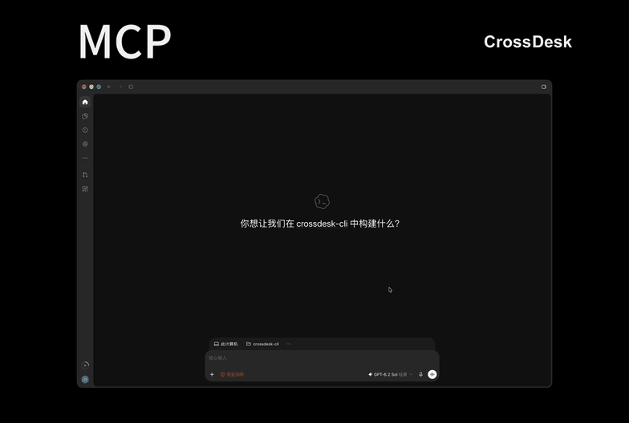

<div align="center">
  
  <p>Ứng dụng điều khiển máy tính từ xa nhẹ, đa nền tảng, hỗ trợ kết nối từ máy tính, trình duyệt, thiết bị di động và terminal; xem và điều khiển tập trung nhiều thiết bị bằng DeskHub.</p>
  <p><a href="https://www.crossdesk.cn/">Trang web chính thức</a> · <a href="https://github.com/thuongtin/crossdesk/releases">Tải ứng dụng</a> · <a href="#build">Hướng dẫn biên dịch</a> · <a href="https://web.crossdesk.cn/">Mở ứng dụng Web</a> · <a href="README_EN.md">English</a> · <a href="README_ZH.md">中文</a> · <a href="README_JA.md">日本語</a></p>
</div>

<div align="center">

[](#download)

[](#download)

[](https://github.com/thuongtin/crossdesk/releases)
[](https://www.npmjs.com/package/@chunkdash/crossdesk-cli)
[](https://github.com/kunkundi/crossdesk/actions/workflows/build.yml)
[](LICENSE)
[](https://github.com/kunkundi/crossdesk/stargazers)

</div>

<p align="center">
  <a href="https://trendshift.io/repositories/17514?utm_source=repository-badge&amp;utm_medium=badge&amp;utm_campaign=badge-repository-17514" target="_blank" rel="noopener noreferrer"></a>
</p>

<p align="center">
  <a href="https://trendshift.io/repositories/17514?utm_source=trendshift-badge&amp;utm_medium=badge&amp;utm_campaign=badge-trendshift-17514" target="_blank" rel="noopener noreferrer"></a>
  <a href="https://trendshift.io/repositories/17514?utm_source=trendshift-badge&amp;utm_medium=badge&amp;utm_campaign=badge-trendshift-17514" target="_blank" rel="noopener noreferrer"></a>
  <a href="https://trendshift.io/repositories/17514?utm_source=trendshift-badge&amp;utm_medium=badge&amp;utm_campaign=badge-trendshift-17514" target="_blank" rel="noopener noreferrer"></a>
</p>

## Nhà tài trợ đặc biệt

<table border="1">
  <tr>
    <td align="center" valign="middle" width="160">
      <a href="https://crossdesk.hualong-ai.com/">
        
      </a>
    </td>
    <td valign="middle">
      <p><strong><a href="https://crossdesk.hualong-ai.com/">HuaLongAI 华龙算力</a></strong></p>
      <p>Dịch vụ trung chuyển API ổn định, hiệu quả, chuyên về Codex, Kiro không chèn nội dung và các mô hình dòng Claude. 100% lấy trực tiếp từ nguồn chính thức, không pha trộn, độ sẵn sàng cao, SLA trung bình trên 99,2%. Tính phí minh bạch, hóa đơn theo từng token có thể đối soát từng giao dịch, hỗ trợ hợp đồng doanh nghiệp và hóa đơn.</p>
    </td>
  </tr>
</table>

## Giới thiệu

CrossDesk cho phép bạn kết nối đến máy tính từ xa từ máy tính, trình duyệt, điện thoại hoặc terminal (CLI máy tính), đồng thời xem và điều khiển tập trung nhiều thiết bị qua DeskHub. Dự án dựa trên [MiniRTC](https://github.com/kunkundi/minirtc), hỗ trợ self-host.

[Tính năng chính](#features) · [Tải xuống và nền tảng hỗ trợ](#download) · [Hướng dẫn biên dịch](#build) · [Kết nối nhanh](#quick-start) · [CLI terminal](#cli) · [Agent / MCP](#mcp) · [Kết nối IP trực tiếp](#lan-direct) · [Thiết bị đáng tin cậy](#trusted-devices) · [Xem trước giao diện](#preview) · [Hướng dẫn sử dụng](docs/USER_GUIDE.md) · [Danh mục tài liệu](docs/README.md) · [Self-host](#self-hosting) · [Tài liệu và phản hồi](#development) · [Tài trợ](#sponsor)

<a id="features"></a>

## Tính năng chính

- **Điều khiển từ xa đa nền tảng:** Máy tính Windows, macOS, Linux điều khiển lẫn nhau; truy cập máy tính từ trình duyệt và ứng dụng iOS / Android native; bản HarmonyOS cho PC và thiết bị di động đang trong giai đoạn phát triển.
- **Kết nối IP trực tiếp trong mạng LAN:** Ứng dụng máy tính và ứng dụng di động Android, iOS, HarmonyOS có thể kết nối đến máy tính bằng IP, cổng và mật khẩu sáu ký tự, không cần dịch vụ signaling đám mây; hỗ trợ cổng riêng, nhớ mật khẩu và hiển thị thiết bị gần đây theo chế độ.
- **Điều khiển từ terminal:** Xem và điều khiển máy tính từ xa bằng ID thiết bị trong terminal, hỗ trợ hình ảnh ANSI / Kitty / Sixel, thu phóng và di chuyển từng vùng, chế độ lệnh cục bộ liên tục và phần mở rộng Pi; có thể biên dịch riêng.
- **DeskHub:** Xem trước nhiều thiết bị theo thời gian thực, phân nhóm, phóng to để điều khiển, điều khiển nhóm và gửi tệp hàng loạt.
- **Hình ảnh và âm thanh:** Hỗ trợ H.264, AV1 và âm thanh từ xa. Với kết nối gốc, khi cả hai bên đều hỗ trợ mã hóa và giải mã phần cứng HEVC thì có thể chọn H.265: Windows dùng Media Foundation hoặc bộ mã hóa NVIDIA, macOS dùng VideoToolbox, Linux dùng card NVIDIA tương thích. Có thể điều chỉnh chất lượng hình ảnh, tốc độ khung hình và độ phân giải màn hình từ xa ngay trong phiên; ghi nhớ lựa chọn độ phân giải đã được xác nhận, khôi phục chế độ hiển thị ban đầu khi máy điều khiển cuối cùng ngắt kết nối. Khả năng sử dụng tùy thuộc nền tảng và thiết bị.
- **Cộng tác hằng ngày:** Chuyển nhiều màn hình, bàn phím, chuột và tổ hợp phím, clipboard văn bản; trình duyệt tệp hai khung hỗ trợ duyệt thư mục, truyền tệp và thư mục hai chiều, kéo thả và quản lý tác vụ.
- **Agent / MCP:** Cấp quyền cho Agent quan sát và thao tác máy tính từ xa qua dịch vụ MCP trên máy này, cung cấp giám sát thời gian thực, tiếp quản thủ công, nhiều phiên, công cụ clipboard và tệp; có thể cài gói MCP tương ứng với nền tảng.
- **Thiết bị đáng tin cậy:** Ứng dụng máy tính có thể bật giới hạn thiết bị đáng tin cậy để xác minh danh tính thiết bị ngoài mật khẩu kết nối; hỗ trợ sao chép và dán thông tin ghép đôi, thêm trước các thiết bị được phép truy cập máy này.
- **Triển khai và vận hành:** Kết nối trực tiếp P2P, TURN relay, mã hóa nội dung đa phương tiện SRTP, self-host, điều khiển Windows từ xa trước khi đăng nhập và chạy Linux headless.

<a id="download"></a>

## Tải xuống và nền tảng hỗ trợ

Bản máy tính CrossDesk Postcard (macOS, Windows, Linux) tải từ [Releases của bản fork](https://github.com/thuongtin/crossdesk/releases); chọn gói khớp hệ điều hành và kiến trúc CPU của bạn. Không cài gói máy tính từ trang web hay Releases của dự án gốc: gói đó thay bản Postcard và mất cấu hình máy chủ báo hiệu nội bộ. Ứng dụng di động và [ứng dụng Web](https://web.crossdesk.cn/) vẫn do dự án gốc phát hành trên [trang web chính thức](https://www.crossdesk.cn/).

| Nền tảng | Phạm vi hỗ trợ và yêu cầu cài đặt |
| --- | --- |
| Windows | **Điều khiển / được điều khiển**; Windows 10+, x64; gói cài đặt `.exe`, cũng hỗ trợ bản portable không cần cài đặt |
| macOS | **Điều khiển / được điều khiển**; macOS 14.0+; chọn `.pkg` x64 / arm64 theo Intel / Apple Silicon |
| Linux | **Điều khiển / được điều khiển**; Ubuntu 20.04+, mức cơ sở glibc 2.31; `.deb` amd64 / arm64 |
| iOS / iPadOS | **Chỉ điều khiển**; cài từ [App Store](https://apps.apple.com/app/id6828859211), xem yêu cầu hệ thống của bản trên cửa hàng tại trang ứng dụng; mã nguồn hiện nhắm tới iOS 16.0+, bạn cũng có thể tự biên dịch và ký |
| Android | **Chỉ điều khiển**; Android 8.0+, arm64; tải APK đã ký để cài đặt hoặc tự biên dịch |
| HarmonyOS PC (bản phát triển) | **Điều khiển / được điều khiển**; API 26, arm64; dùng DevEco để biên dịch và ký HAP, vẫn đang kiểm thử nghiệm thu trên thiết bị thật |
| Điện thoại / máy tính bảng HarmonyOS (bản phát triển) | **Chỉ điều khiển**; API 20+, arm64; dùng DevEco để biên dịch và ký HAP, vẫn đang kiểm thử nghiệm thu trên thiết bị thật |
| Web | **Chỉ điều khiển**; trình duyệt hỗ trợ WebRTC; không cần cài ứng dụng trên máy điều khiển |
| CLI terminal (bản phát triển) | **Chỉ điều khiển**; nhắm tới phân phối cho macOS / Linux (x64, arm64) và Windows (x64); [cài qua npm](#cli-npm) hoặc biên dịch từ mã nguồn, xem yêu cầu sử dụng trong [tài liệu CLI](apps/cli/README.md) |
| MCP (bản phát triển) | **Chỉ điều khiển**; thao tác máy từ xa và giám sát hình ảnh trong Codex hoặc DSH; DSH cài một gói plugin, Codex cần Node.js 22+, xem [cài đặt và sử dụng](apps/mcp/README.md) |

Bạn hãy chọn gói cài đặt khớp hệ điều hành và chip của mình theo trang tải xuống. Các tính năng bản phát triển có thể chưa nằm trong gói đã phát hành; xem ghi chú của Release tương ứng để biết chi tiết.

- **Linux:** Máy đã có môi trường desktop chọn bản thường `crossdesk-linux-…deb`; máy chủ cần màn hình Xfce độc lập chọn `crossdesk-virtual-desktop-xfce-…deb`. Chọn một trong hai; xem cách cài đặt và khởi động trong [hướng dẫn sử dụng](docs/USER_GUIDE.md#installation) và [chạy headless](docs/HEADLESS.md).
- **macOS:** Lần chạy đầu, cấp quyền ghi màn hình và trợ năng theo lời nhắc; quyền thứ nhất dùng để ghi hình màn hình, quyền thứ hai dùng cho nhập liệu bàn phím và chuột từ xa. [Giải thích về quyền](docs/USER_GUIDE.md#installation)
- **iOS:** Ưu tiên cài từ [App Store](https://apps.apple.com/app/id6828859211); sản phẩm biên dịch chưa ký trên GitHub vẫn cần bạn tự ký, xem các bước trong [hướng dẫn biên dịch iOS](apps/ios/README.md). HarmonyOS cần biên dịch và ký bằng DevEco, xem [tài liệu HarmonyOS](apps/harmony/README.md).

<a id="build"></a>

## Hướng dẫn biên dịch

Ứng dụng máy tính sử dụng Xmake để biên dịch. Chuẩn bị Git, Xmake 3.1.1 hoặc mới hơn, cài chuỗi công cụ biên dịch và các phụ thuộc cho nền tảng tương ứng, sau đó lấy mã nguồn và các submodule:

```bash
git clone --recurse-submodules https://github.com/thuongtin/crossdesk.git
cd crossdesk
```

- **Ứng dụng máy tính:** Làm theo các bước cho [Windows](docs/BUILD.md#windows), [macOS](docs/BUILD.md#macos) hoặc [Linux](docs/BUILD.md#linux) để cấu hình, biên dịch và chạy; xem đóng gói, ký và cấu hình CI trong [hướng dẫn biên dịch đầy đủ](docs/BUILD.md).
- **Thiết bị di động và HarmonyOS:** [iOS / iPadOS](apps/ios/README.md), [Android](apps/android/README.md), [điện thoại / máy tính bảng HarmonyOS](apps/harmony/README.md), [HarmonyOS PC](apps/harmony/desktop-port/README.md).
- **Terminal và tích hợp:** [Biên dịch và chạy CLI](apps/cli/README.md), [biên dịch và tích hợp MCP](apps/mcp/DEVELOPMENT.md).

<a id="quick-start"></a>

## Kết nối nhanh

### Kết nối bằng ID thiết bị

1. **Chuẩn bị máy tính được điều khiển.** Cài đặt và chạy CrossDesk, chuyển sang chế độ kết nối ID, chờ hiển thị “Đã kết nối máy chủ”, xem ID máy này và mật khẩu trong “Màn hình máy này”.
2. **Bắt đầu kết nối.** Nhập ID gồm 9 chữ số của máy được điều khiển trong CrossDesk trên máy tính khác, nhấn “Kết nối”; bạn cũng có thể dùng ứng dụng di động native hoặc [ứng dụng Web](https://web.crossdesk.cn/).
3. **Xác minh mật khẩu.** Nhập mật khẩu kết nối hiện tại của máy được điều khiển, chờ hình ảnh từ xa xuất hiện. Trên máy tính, bạn có thể chọn “Nhớ mật khẩu”, sau đó kết nối lại từ “Kết nối gần đây”.

Khi dùng máy chủ tự triển khai, hai bên cần kết nối cùng dịch vụ; hãy cập nhật máy chủ trước khi nâng cấp ứng dụng. Xem thêm thao tác kết nối và mật khẩu trong [hướng dẫn sử dụng](docs/USER_GUIDE.md#quick-start); khi kết nối thất bại, màn hình đen hoặc không thao tác được bàn phím và chuột, xem [câu hỏi thường gặp](docs/FAQ.md).

<a id="lan-direct"></a>

### Kết nối IP trực tiếp qua mạng LAN

Trên điện thoại hoặc máy tính bảng, dán địa chỉ hiển thị trên máy tính được điều khiển vào ô **ID thiết bị, IP hoặc tên miền** ở màn hình chính, rồi nhập **Mật khẩu kết nối IP trực tiếp** của máy tính đó. Trên ứng dụng máy tính, làm như sau.

1. **Chuyển chế độ.** Khi dùng ứng dụng máy tính, nhấn nút chế độ ở góc trên bên trái để chuyển sang **Chế độ kết nối IP**. Nếu không thấy nút, chọn **Bật kết nối IP** trong **Cài đặt → Chung → Kết nối mạng** rồi lưu.
2. **Nhập địa chỉ.** Trên máy điều khiển, nhập `IP:cổng` hiển thị trên máy được điều khiển, ví dụ `192.168.1.20:52888` hoặc `[2001:db8::20]:52888`, rồi nhấn “Kết nối”. Khi chỉ nhập IP, cổng mặc định là **52888**; hãy căn cứ vào cổng thực tế hiển thị trên giao diện bên kia.
3. **Nhập mật khẩu.** Nhập **mật khẩu gồm 6 chữ cái tiếng Anh hoặc chữ số** hiển thị trên máy được điều khiển ở chế độ kết nối IP trực tiếp; bạn có thể chọn “Nhớ mật khẩu”. Khi chuyển chế độ, “Kết nối gần đây” cũng chuyển sang lịch sử thiết bị của chế độ tương ứng.

Máy điều khiển và máy tính được điều khiển cần truy cập được nhau trong mạng LAN hoặc VPN; mạng có thể có hoặc không có Internet, phiên kết nối trực tiếp không phụ thuộc dịch vụ signaling đám mây. Trong cửa sổ chính, bạn có thể trực tiếp đổi IP máy này, cổng và mật khẩu. Mặc định bật lắng nghe trên tất cả interface mạng, hỗ trợ IPv4 và IPv6, cho phép kết nối qua giao diện như VPN; có thể điều chỉnh trong “Kết nối mạng” của cài đặt. Tắt “Bật kết nối IP” trong cài đặt sẽ dừng lắng nghe, ngắt các phiên IP trực tiếp và ẩn nút chế độ. Xem [hướng dẫn kết nối IP trực tiếp](docs/USER_GUIDE.md#lan-direct).

<a id="trusted-devices"></a>

### Chỉ cho phép thiết bị đáng tin cậy kết nối (tùy chọn)

Giới hạn thiết bị đáng tin cậy trên ứng dụng máy tính **mặc định tắt**, áp dụng cho cả kết nối ID và IP trực tiếp. Khi bật, máy điều khiển vẫn cần vượt qua xác minh mật khẩu hiện có và giữ khóa riêng ghép đôi của thiết bị trong danh sách tin cậy; chỉ biết ID và mật khẩu không thể vượt qua giới hạn này.

1. **Sao chép thông tin ghép đôi trên máy điều khiển.** Mở **Cài đặt → Chung → Bảo vệ quyền riêng tư → Thiết bị đáng tin cậy → Quản lý**, nhấn **Sao chép thông tin ghép đôi** trong **Thông tin ghép đôi máy này**.
2. **Thêm máy điều khiển trên máy được điều khiển.** Mở cùng giao diện quản lý, dán thông tin nhận được vào ô **Thêm thiết bị đáng tin cậy**, nhấn **Thêm** để thêm vào danh sách; không cần xác nhận lại hay thiết lập kết nối từ xa trước.
3. **Bật giới hạn trên máy được điều khiển.** Quay lại cài đặt, chọn **Chỉ cho phép thiết bị đáng tin cậy điều khiển** rồi lưu. Sau đó bắt đầu kết nối bằng ID hoặc IP và xác minh mật khẩu như bình thường.

Thông tin ghép đôi chỉ gồm khóa công khai, tên thiết bị và ID, không có khóa riêng hay mật khẩu; nên truyền qua kênh đáng tin cậy. Sau khi thêm, bạn có thể nhấn **Xem fingerprint** để đối chiếu với máy điều khiển; cũng có thể thêm chính máy này, cùng một khóa công khai sẽ không được thêm trùng. Tin cậy là một chiều; nếu cần điều khiển lẫn nhau, bạn nên thêm bên kia trên cả hai máy.

Việc thêm và xóa được lưu ngay; khi giới hạn đang bật, **Xóa tin cậy** sẽ ngắt phiên của thiết bị tương ứng, danh sách rỗng sẽ từ chối tất cả máy điều khiển. Bạn cũng có thể thêm máy điều khiển đã hoàn tất xác minh danh tính từ các thiết bị đã kết nối trong giao diện quản lý.

**Phạm vi tương thích:** Dùng phiên bản mới có hỗ trợ ghép đôi của ứng dụng máy tính, iOS, Android hoặc HarmonyOS di động. Trên điện thoại và máy tính bảng, sao chép thông tin ghép đôi từ “Cài đặt → Thông tin ghép đôi máy này”, rồi thêm vào máy tính được điều khiển. Ứng dụng cũ và CLI terminal hiện tại không thể kết nối đến máy được điều khiển đang bật giới hạn này.

Trước khi cài đặt lại, xóa dữ liệu ứng dụng hoặc chuyển máy tính, hãy xem [sao lưu và di chuyển danh tính](docs/CONNECTIONS.md#backup). Chỉ lưu ID và mật khẩu không đủ để khôi phục danh tính máy tính đã liên kết; sau khi thay đổi danh tính thiết bị cần ghép đôi lại.

<a id="preview"></a>

## Xem trước giao diện

### Ứng dụng máy tính

Thông tin xác thực máy này, kết nối từ xa và thiết bị gần đây tập trung trong cửa sổ chính; góc trên bên trái có nút chuyển chế độ kết nối và nút mở DeskHub.

<p align="center">
  
</p>

### Chế độ kết nối IP trực tiếp

Đổi IP máy này, cổng và mật khẩu, kết nối bằng địa chỉ bên kia; bên dưới hiển thị riêng các thiết bị LAN gần đây.

<p align="center">
  
</p>

<a id="deskhub"></a>

### DeskHub

Xem nhiều thiết bị theo nhóm, nhấn hình ảnh để phóng to rồi chọn tiếp quản điều khiển; hỗ trợ kết nối hàng loạt, tắt tiếng và gửi tệp.

<p align="center">
  
</p>

Điều khiển nhóm gửi thao tác nhập đến tất cả thiết bị đã kết nối; đóng DeskHub sẽ ngắt toàn bộ kết nối từ xa. Xem phạm vi thao tác và cách dùng chi tiết trong [hướng dẫn DeskHub](docs/USER_GUIDE.md#deskhub).

### Truyền tệp hai khung

Mở truyền tệp trên thanh công cụ phiên để duyệt đồng thời thư mục máy này và máy từ xa, chọn tệp hoặc thư mục rồi gửi, hoặc kéo thả giữa hai khung; danh sách tác vụ hiển thị tiến độ và cho phép hủy tác vụ chưa hoàn tất. Duyệt thư mục từ xa cần máy được điều khiển tương thích.

<p align="center">
  
</p>

<a id="session"></a>
<a id="settings"></a>

## Thao tác phiên và cài đặt

Phiên từ xa hỗ trợ chuyển màn hình, điều chỉnh chất lượng hình ảnh và tốc độ khung hình, âm thanh, đồng bộ clipboard văn bản và truyền tệp hai chiều. Thanh công cụ cũng cho phép xem trạng thái mạng và điều khiển chế độ riêng tư; trong cài đặt máy tính có thể cấu hình bật/tắt IP trực tiếp, giới hạn thiết bị đáng tin cậy, mã hóa, relay, self-host, tạm dừng video khi thu nhỏ và ngân sách hình ảnh của DeskHub.

Khi máy được điều khiển dùng Windows, macOS hoặc Linux X11, bạn có thể chọn chế độ mà màn hình hiện tại hỗ trợ trong **Cài đặt hình ảnh → Độ phân giải**, không cần kết nối lại. Ứng dụng máy tính và di động native ghi nhớ lựa chọn đã được máy từ xa xác nhận thành công, rồi áp dụng lại khi kết nối lại nếu vẫn được hỗ trợ; khi máy điều khiển cuối cùng ngắt kết nối, máy được điều khiển khôi phục chế độ hiển thị trước lần điều chỉnh đầu tiên của đợt kết nối này. Linux cần ghi hình X11 và RandR; Wayland / XWayland hiện chưa hỗ trợ điều chỉnh này.

<p align="center">
  
</p>

- [Thao tác phiên](docs/USER_GUIDE.md#session): thanh công cụ, clipboard văn bản, lưu tệp và chế độ riêng tư.
- [Cài đặt và cập nhật ứng dụng](docs/USER_GUIDE.md#settings): cài đặt chung, truyền hình ảnh DeskHub và kiểm tra phiên bản.
- [Hướng dẫn DeskHub](docs/deskhub.md): sắp xếp thiết bị, điều khiển nhóm, truyền tệp hàng loạt và giảm băng thông sử dụng.

<a id="cli"></a>

## Ứng dụng CLI terminal

`crossdesk-cli` kết nối đến máy tính được điều khiển bằng ID thiết bị gồm 9 chữ số trong terminal; mặc định chỉ xem và tắt tiếng. Terminal thông thường dùng hình ảnh ký tự ANSI; terminal hỗ trợ giao thức đồ họa Kitty hoặc Sixel có thể hiển thị hình ảnh điểm ảnh. Bạn có thể chuyển màn hình, điều chỉnh chất lượng hình ảnh, phóng to chi tiết và di chuyển khung nhìn, hoặc chủ động bật điều khiển bàn phím và chuột. CLI có thể biên dịch độc lập với GUI máy tính; máy tính được điều khiển vẫn cần chạy CrossDesk và cung cấp phiên đồ họa có thể ghi hình, dịch vụ signaling cần hỗ trợ đăng ký danh tính tạm thời `cli`.

### Xem trước hình ảnh

<table>
  <tr>
    <th width="50%">Hình ảnh ký tự ANSI</th>
    <th width="50%">Hình ảnh điểm ảnh qua giao thức Kitty</th>
  </tr>
  <tr>
    <td></td>
    <td></td>
  </tr>
  <tr>
    <td>Hiển thị đường nét màn hình bằng ký tự màu, phù hợp với terminal thông thường; dùng <code>+/-</code> hoặc con lăn để thu phóng tại vị trí chuột khi xem từng vùng.</td>
    <td>Hiển thị trực tiếp hình ảnh điểm ảnh, phù hợp với terminal hỗ trợ giao thức đồ họa Kitty như Ghostty.</td>
  </tr>
</table>

ANSI hiển thị hình ảnh bằng ký tự, Kitty có thể hiển thị hình ảnh điểm ảnh; kết quả thực tế phụ thuộc vào khả năng hỗ trợ của terminal, phông chữ và kích thước cửa sổ.

<a id="cli-npm"></a>

### Cài đặt qua npm và kết nối

Chuẩn bị **Node.js 22 trở lên** và npm, cài từ [@chunkdash/crossdesk-cli](https://www.npmjs.com/package/@chunkdash/crossdesk-cli). npm tự chọn chương trình native theo hệ điều hành và kiến trúc CPU, không cần cài Xmake hay chuỗi công cụ biên dịch C++.

```sh
npm install -g @chunkdash/crossdesk-cli@latest
crossdesk-cli doctor --json
crossdesk-cli 123456789
```

Thay `123456789` bằng ID thiết bị gồm 9 chữ số của máy được điều khiển; khi kết nối, nhập mật khẩu ẩn theo lời nhắc. Mặc định chỉ xem và tắt tiếng; `doctor` chỉ kiểm tra môi trường máy này, không bắt đầu kết nối. Để cập nhật lên bản mới nhất, chạy lại `npm install -g @chunkdash/crossdesk-cli@latest` ở trên.

Nếu không cần cài toàn cục, bạn cũng có thể dùng `npx`; lần chạy đầu sẽ tải gói của nền tảng tương ứng:

```sh
npx @chunkdash/crossdesk-cli@latest doctor --json
npx @chunkdash/crossdesk-cli@latest 123456789
```

Hãy cài gói đầu vào thống nhất `@chunkdash/crossdesk-cli` và giữ các phụ thuộc tùy chọn của npm, không thêm `--omit=optional`; chỉ cài gói nền tảng sẽ không đăng ký lệnh `crossdesk-cli`. Xem yêu cầu chạy trên từng nền tảng, di chuyển từ gói cũ và khắc phục sự cố trong [tài liệu phân phối npm](apps/cli/docs/npm-distribution.md).

### Thao tác thường dùng

Mặc định chỉ xem và tắt tiếng. Ở chế độ chỉ xem, nhấn `c` để bật điều khiển bàn phím và chuột, nhấn `+/-` hoặc dùng con lăn để thu phóng, nhấn `f` để trở về toàn cảnh. **Để thoát ở chế độ điều khiển, nhấn `Ctrl+]` trước, rồi nhấn `q`**; nếu không, phím thông thường sẽ được gửi đến máy tính từ xa.

```sh
# Terminal thông thường, hiển thị hình ảnh bằng ký tự
crossdesk-cli 123456789 --renderer ansi

# Terminal hỗ trợ giao thức đồ họa Kitty, hiển thị hình ảnh bằng điểm ảnh
crossdesk-cli 123456789 --renderer kitty
```

CLI kết nối bằng ID thiết bị, hiện chưa cung cấp kết nối IP trực tiếp, phát âm thanh, truyền tệp hay đồng bộ clipboard; cũng không hỗ trợ kết nối đến máy tính đang bật giới hạn thiết bị đáng tin cậy. Máy tính được điều khiển cần chạy CrossDesk và có màn hình nền khả dụng. Người dùng self-host cần dùng máy chủ hỗ trợ kết nối CLI.

[Hướng dẫn CLI đầy đủ](apps/cli/README.md) · [Tham số, phần mở rộng Pi và tự biên dịch](apps/cli/docs/terminal-client.md) · [Khắc phục sự cố cài đặt](apps/cli/docs/npm-distribution.md)

<a id="mcp"></a>

## Agent và MCP

[CrossDesk MCP](apps/mcp/README.md) cho phép bạn giao tác vụ từ xa trong cuộc trò chuyện Codex hoặc DeepSeek Harness và xem hình ảnh từ xa ở bên phải. Máy tính từ xa chạy CrossDesk; sau khi cài đặt trên máy này theo bảng dưới, chọn thiết bị và cấp quyền trong bảng điều khiển.

<p align="center">
  
</p>

| Môi trường sử dụng | Cài đặt và cấu hình | Hình ảnh từ xa |
| --- | --- | --- |
| Codex bản máy tính | [Hướng dẫn cài Codex](apps/mcp/README.md#install-codex): đăng ký MCP, không cần plugin bổ sung | Agent mở trình duyệt tích hợp bên phải |
| DeepSeek Harness bản máy tính (DSH) | [Hướng dẫn cài DSH](apps/mcp/README.md#install-dsh): chỉ cài một gói plugin MCP tương ứng với nền tảng, tự động đăng ký dịch vụ | Plugin tự mở thanh bên của cuộc trò chuyện hiện tại |

1. [Tải gói cài đặt cho nền tảng máy này](apps/mcp/README.md#install-package), rồi hoàn tất cài đặt theo bảng trên.
2. Yêu cầu Agent mở CrossDesk, chọn thiết bị trong bảng giám sát, nhập mật khẩu kết nối và chọn chỉ xem hoặc cho phép điều khiển. Mật khẩu được nhập trong bảng điều khiển cục bộ; việc lưu mật khẩu và cho phép tự động kết nối sau này được thiết lập riêng.
3. Agent thực hiện tác vụ qua ảnh chụp màn hình, bàn phím, chuột và các công cụ màn hình có cấu trúc; người dùng có thể giám sát theo thời gian thực, tạm dừng Agent, tiếp quản thủ công hoặc ngắt kết nối.

Hỗ trợ tối đa 8 phiên thiết bị song song, quan sát nhiều màn hình, clipboard văn bản từ xa, duyệt và truyền tệp, âm thanh, khóa màn hình hệ thống và quy trình mở khóa bằng mật khẩu nhập tại máy này. Thao tác cửa sổ và trợ năng chịu giới hạn của nền tảng từ xa và quyền hệ thống; một số công cụ cần phiên bản máy được điều khiển mới. Khả năng bảng điều khiển trên trình duyệt, terminal và MCP Apps tùy thuộc MCP host; xem cấu hình và phạm vi tương thích trong [tài liệu MCP](apps/mcp/README.md).

<a id="mobile"></a>

## Thiết bị di động và HarmonyOS

<a id="ios"></a>

### iOS / iPadOS

Bạn có thể cài ứng dụng điều khiển native từ [App Store](https://apps.apple.com/app/id6828859211), hỗ trợ cảm ứng và chuột ảo, nhiều màn hình, âm thanh từ xa, gửi nhận tệp và clipboard văn bản. Nút “Clipboard” trong menu nổi cho phép chủ động gửi văn bản máy này, giới hạn mỗi lần là 128 KiB; cài đặt hình ảnh cho phép điều chỉnh độ phân giải màn hình từ xa được hỗ trợ và ghi nhớ lựa chọn đã xác nhận. iPhone / iPad hiện không thể làm máy tính được điều khiển; kiểm tra cập nhật trong ứng dụng dẫn đến App Store.

[Hướng dẫn sử dụng](docs/USER_GUIDE.md#ios) · [Biên dịch và ký](apps/ios/README.md)

<a id="android"></a>

### Android

Ứng dụng điều khiển native hỗ trợ cảm ứng và bàn phím, chuột ngoài, chuyển nhiều màn hình, gửi nhận tệp, clipboard văn bản và cài đặt hình ảnh. Khi chuyển ứng dụng, ưu tiên duy trì phiên bằng hình trong hình; nếu không hỗ trợ hình trong hình, thử giữ kết nối bằng thông báo nền. Menu nổi cho phép bật/tắt chế độ riêng tư của máy tính. Điện thoại và máy tính bảng Android hiện không thể làm máy được điều khiển.

[Hướng dẫn sử dụng](docs/USER_GUIDE.md#android) · [Biên dịch từ mã nguồn](apps/android/README.md)

<a id="harmonyos"></a>

### HarmonyOS (bản phát triển)

Bản PC có thể điều khiển và được điều khiển, tái sử dụng giao diện máy tính và DeskHub; điện thoại và máy tính bảng dùng ứng dụng điều khiển ArkUI native, hỗ trợ cảm ứng, bàn phím và chuột ngoài, nhiều màn hình, clipboard văn bản và gửi nhận tệp. Ghi màn hình và điều khiển nhập liệu trên PC cần quyền hệ thống; việc nghiệm thu trên thiết bị thật và phiên dài hạn vẫn đang tiến hành.

[Sử dụng và giới hạn](docs/USER_GUIDE.md#harmonyos) · [Biên dịch và ký](apps/harmony/README.md) · [Tài liệu PC](apps/harmony/desktop-port/README.md) · [Tính năng di động](apps/harmony/MOBILE_PARITY.md)

<a id="windows-service"></a>

## Truy cập không giám sát và chạy headless

- **Windows:** CrossDesk Service hỗ trợ điều khiển màn hình khóa, đăng nhập và màn hình bảo mật. Sau khi bật “Tự khởi động cùng hệ thống” trong bản Release đã cài đặt, máy dùng cùng ID và mật khẩu trước và sau đăng nhập; sau khi người dùng đăng nhập, ứng dụng tự khởi động vào khay hệ thống, các kết nối từ xa hiện có vẫn được giữ. Bản portable và Debug không cung cấp công tắc này. Khi không có màn hình, ứng dụng sẽ thử chuẩn bị màn hình ảo và ưu tiên khôi phục độ phân giải đã ghi nhận. Xem giới hạn tính năng và lệnh bật/tắt trong [hướng dẫn Windows không giám sát](docs/USER_GUIDE.md#windows-service).
- **macOS:** Trên máy Mac đã đăng nhập nhưng không cắm màn hình, CrossDesk có thể tự tạo màn hình ảo mà không cần cài Snug riêng. Tính năng này có sẵn trong CrossDesk, phần màn hình ảo được chuyển thể từ mã nguồn [Snug 2.8.0](https://github.com/zephyr4123/snug/tree/v2.8.0).
- **Linux:** Bạn có thể tái sử dụng màn hình hiện có hoặc tạo phiên Xvfb / Xfce độc lập; xem cách thực hiện trong [chạy Linux headless](docs/HEADLESS.md).

<a id="self-hosting"></a>

## Self-host

Bạn có thể tự triển khai dịch vụ signaling và TURN relay, rồi bật trong “Cài đặt → Chung → Cấu hình máy chủ self-host” của ứng dụng. Máy điều khiển và máy được điều khiển cần kết nối cùng dịch vụ.

[Hướng dẫn triển khai](docs/SELF_HOSTING.md) · [Cấu hình ứng dụng](docs/USER_GUIDE.md#self-hosting) · [Mã nguồn máy chủ](https://github.com/kunkundi/crossdesk-server) · [Triển khai ứng dụng Web](https://github.com/kunkundi/crossdesk-web-client)

<a id="development"></a>

## Tài liệu và phản hồi

- [Hướng dẫn sử dụng](docs/USER_GUIDE.md): cài đặt, kết nối, thao tác phiên, cài đặt tùy chọn và truy cập không giám sát.
- [Câu hỏi thường gặp](docs/FAQ.md): kết nối thất bại, màn hình đen, quyền hệ thống và vị trí tệp.
- [Kết nối và thiết bị đáng tin cậy](docs/CONNECTIONS.md): chọn phương thức kết nối, ghép đôi và di chuyển danh tính.
- [Cập nhật ứng dụng](docs/UPDATER.md): kiểm tra cập nhật, cài đặt và xử lý khi thất bại.
- [Biên dịch từ mã nguồn](docs/BUILD.md): phụ thuộc, biên dịch, đóng gói và ký.
- [Kiến trúc và tích hợp](docs/README.md#biên-dịch-và-tích-hợp): kiến trúc GUI và kết nối, giao diện CLI / MCP, hỗ trợ từng nền tảng.
- [Phiên bản và phát hành](docs/VERSIONING.md): đồng bộ phiên bản thành phần, số bản phát hành và manifest cập nhật.

Khi gặp sự cố, bạn có thể mở **Phản hồi và góp ý** trong menu chính của ứng dụng máy tính, xuất nhật ký chẩn đoán rồi gửi gói ZIP cho quản trị viên CrossDesk. Hãy kèm hệ điều hành hai bên, phiên bản ứng dụng, phương thức kết nối, thông báo lỗi và các bước tái hiện; kiểm tra thông tin riêng tư trong nhật ký và ảnh chụp trước khi chia sẻ. Không gửi nhật ký hay ảnh chụp của bản CrossDesk Postcard lên trang issue của dự án gốc. Xem [phản hồi và nhật ký chẩn đoán](docs/USER_GUIDE.md#feedback).

<a id="sponsor"></a>

## Tài trợ và ủng hộ

### Người ủng hộ

<p>
  <a href="https://afdian.com/u/41c14324f4b511ee8d785254001e7c00"></a>
  <a href="https://afdian.com/u/0229e818d9a711f1b32852540025c377"></a>
  <a href="https://afdian.com/u/1dfe098add7011f180f252540025c377"></a>
  <a href="https://afdian.com/u/52890a84df4011f1be6a525400c8052f"></a>
  <a href="https://afdian.com/u/49d40918e87311efb07a5254001e7c00"></a>
  <a href="https://afdian.com/u/e9addbece5b211f1970052540025c377"></a>
  <a href="https://afdian.com/u/ec7329c4bc1511eda50252540025c377"></a>
</p>

### Tham gia tài trợ

Nếu CrossDesk hữu ích với bạn, hãy cân nhắc tài trợ qua các nền tảng sau để hỗ trợ phát triển, kiểm thử đa nền tảng và bảo trì dự án. Cảm ơn sự ủng hộ của bạn!

[](https://afdian.com/a/kunkundi)
[](https://ko-fi.com/kunkundi)
[](https://github.com/sponsors/kunkundi)

## Lời cảm ơn và giấy phép

Cảm ơn [HelloGitHub](https://hellogithub.com/), [Bản tin người yêu công nghệ của Ruan Yifeng](https://github.com/ruanyf/weekly) và cộng đồng [LinuxDo](https://linux.do) đã giới thiệu, trao đổi và hỗ trợ.

Copyright (c) 2026 JUNKUN DI.

CrossDesk sử dụng giấy phép [GPL-3.0-only](LICENSE). Xem thông tin quyền riêng tư trong [Chính sách quyền riêng tư](PRIVACY.md#tiếng-việt).

### Chính sách ký mã

CrossDesk sử dụng SignPath.io để ký mã cho các gói phát hành Windows chính thức được biên dịch từ kho mã này.

**Ký mã miễn phí do [SignPath.io](https://signpath.io/) cung cấp, chứng chỉ do [SignPath Foundation](https://signpath.org/) cấp.**

- **Người đóng góp mã và người duyệt mã:** [kunkundi](https://github.com/kunkundi)
- **Người phê duyệt chữ ký:** [kunkundi](https://github.com/kunkundi)
