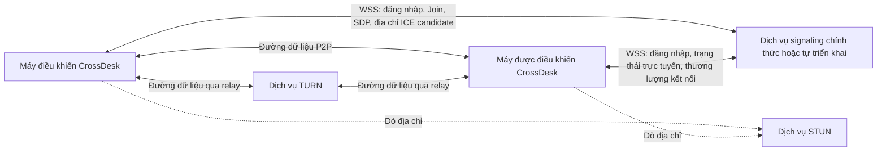
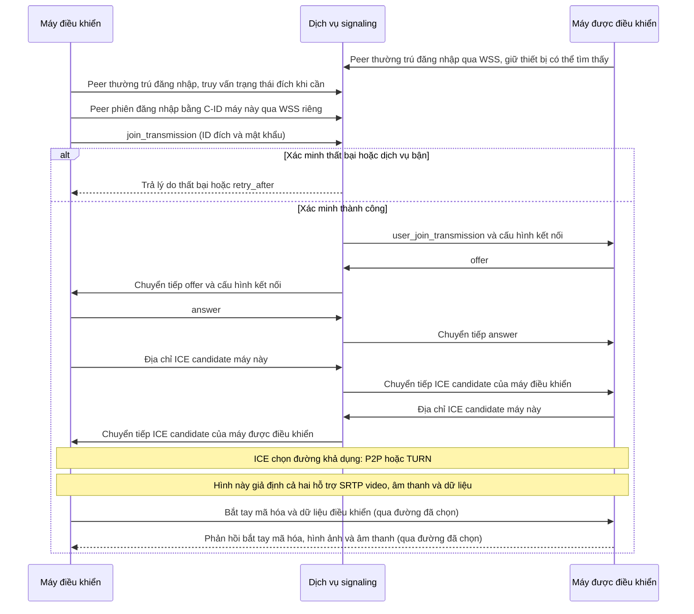
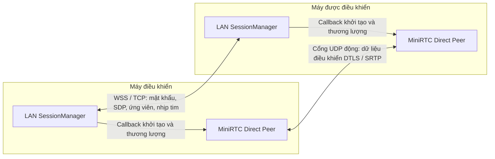
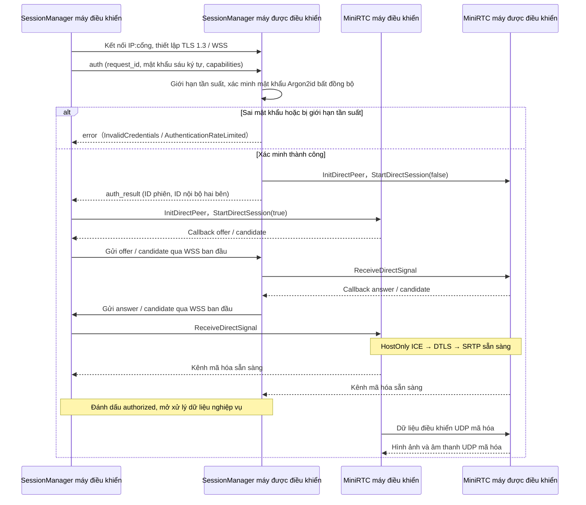
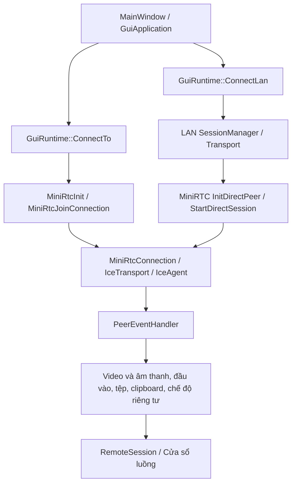

# Kiến trúc kết nối ID và IP trực tiếp

[Trang chủ dự án](../README.md) · [Hướng dẫn sử dụng](USER_GUIDE.md#quick-start) · [Thao tác IP trực tiếp](USER_GUIDE.md#lan-direct) · [Kiến trúc GUI](gui-architecture.md)

Tài liệu này giải thích tô-pô mạng, xác thực danh tính, thương lượng kết nối và vòng đời truyền tải của ứng dụng máy tính. Xem các bước thao tác và chuyển đổi danh tính trong [hướng dẫn kết nối](CONNECTIONS.md); triển khai máy chủ nằm trong dự án [CrossDesk Server](https://github.com/kunkundi/crossdesk-server) riêng.

Đăng nhập máy chủ và xác thực thiết bị đáng tin cậy dùng chung khóa thiết bị máy này nhưng lần lượt xác minh danh tính đăng nhập và quyền truy cập từ xa. Xác minh mật khẩu ở chế độ ID vẫn dùng để cấp quyền kết nối thiết bị đích, xem phần 4.

## 1. Ranh giới hai chế độ

Hai chế độ dùng lại ghi màn hình, mã hóa, truyền âm thanh và video, bàn phím, chuột, xử lý tệp và clipboard. Khác biệt chính là **cách tìm thiết bị, nơi xác minh mật khẩu và kênh trao đổi tham số kết nối**.

“Kết nối ID” không đồng nghĩa “relay qua mạng công cộng”: sau khi tìm thiết bị qua ID, dữ liệu điều khiển có thể kết nối trực tiếp trong mạng cục bộ hoặc xuyên NAT, dùng TURN relay khi cần. “IP trực tiếp” vẫn thương lượng kết nối, chỉ là thông điệp thương lượng trao đổi trực tiếp giữa hai máy.

| Hạng mục | Chế độ kết nối ID | Chế độ IP trực tiếp |
| --- | --- | --- |
| Người dùng nhập | ID thiết bị 9 chữ số và mật khẩu | Địa chỉ IPv4/IPv6 dạng số, cổng tùy chọn và mật khẩu |
| Định vị thiết bị | Thiết bị và trạng thái trực tuyến do dịch vụ signaling quản lý | Kết nối thẳng `IP:cổng` chỉ định |
| Nơi xác minh mật khẩu | Máy điều khiển gửi Join, dịch vụ signaling trả kết quả xác minh | Máy được điều khiển xác minh mật khẩu nhận được trên máy đó |
| Kênh signaling | Cả hai kết nối WSS dịch vụ chính thức hoặc tự triển khai | Máy điều khiển kết nối thẳng WSS máy được điều khiển |
| Chính sách ICE | `ManagedServers`, dùng cấu hình ICE máy chủ gửi xuống | `HostOnly`, giới hạn IPv4/IPv6 hai bên của kết nối WSS này |
| Đường dữ liệu | P2P trực tiếp hoặc dùng TURN theo cấu hình và mạng | UDP trực tiếp hai bên, không dự phòng TURN |
| Yêu cầu mã hóa dữ liệu native | Thương lượng SRTP theo khả năng máy từ xa, giữ nhánh tương thích bản cũ, xem phần 4.1 | Bắt buộc hỗ trợ SRTP video, âm thanh và dữ liệu, nếu không từ chối thiết lập phiên |
| Yêu cầu mạng bên ngoài | Tùy vị trí triển khai signaling và STUN/TURN | Phiên trực tiếp không phụ thuộc dịch vụ mạng bên ngoài |
| Cổng máy này | Người dùng không cần cung cấp cổng lắng nghe điều khiển từ xa cố định | Lưu riêng cổng thương lượng TCP cho mỗi IP cục bộ, lần đầu ưu tiên `52888` |
| Mật khẩu và lịch sử gần đây | Thông tin xác thực ID và bản ghi `cloud_id` | Thông tin xác thực LAN riêng và bản ghi `lan_direct` |

Lưu đồ sau chủ yếu mô tả ứng dụng máy tính native kết nối với nhau. Khi trình duyệt vào qua chế độ ID, MiniRTC dùng `DataChannelConnection` thích ứng WebRTC; không thể kết nối thẳng đầu vào thương lượng WSS LAN để thay giao thức ứng dụng Web.

## 2. Chế độ kết nối ID

### 2.1 Tô-pô mạng

P2P và TURN trên đường nét liền biểu thị đường dữ liệu có thể chọn, không có nghĩa mỗi phiên đồng thời dùng cả hai. Signaling chịu trách nhiệm thông điệp điều khiển, TURN chuyển tiếp dữ liệu; dù triển khai cùng máy chủ vẫn là hai trách nhiệm khác nhau.

### 2.2 Thiết lập kết nối

Trình tự sau lấy ứng dụng máy tính native hai bên hỗ trợ SRTP video, âm thanh và dữ liệu làm ví dụ; xem tương thích bản cũ ở phần 4.1. “Máy điều khiển” trong hình đại diện cả tiến trình ứng dụng; Peer thường trú và Peer phiên điều khiển của nó lập WSS riêng.

1. `GuiRuntime::CreateConnectionPeer()` tạo MiniRTC Peer thường trú máy này, `MiniRtcInit()` kết nối signaling và đăng nhập. Khi điều khiển thiết bị khác, `ConnectTo()` tạo hoặc tái dùng `RemoteSession` và Peer điều khiển tương ứng; Peer phiên đó đăng nhập dưới danh tính `C-<ID-máy-này>`, dùng kết nối signaling riêng.
2. Kết nối tương tác thường dò trực tuyến khi cần; kết nối nền DeskHub có thể xác định khả dụng trực tiếp từ kết quả Join. Nếu chưa có mật khẩu, hỏi bằng hộp thoại cục bộ trước, không gửi trước một yêu cầu mật khẩu rỗng.
3. Lời gọi máy tính hiện tại là `MiniRtcJoinConnection(peer, "ID-đích@mật-khẩu")`, MiniRTC đặt vào `transmission_id` của `join_transmission`, gửi qua WSS đến signaling. Nếu chưa đăng nhập xong, Join chờ kết quả đăng nhập.
4. Thông báo tham gia từ máy chủ khiến máy được điều khiển khởi tạo offer, máy điều khiển trả answer; cả hai chuyển tiếp ICE candidate qua máy chủ. Máy chủ hỗ trợ giao thức mới cung cấp cấu hình ICE và thời hạn cho mỗi kết nối, ứng dụng vẫn giữ đường tương thích máy chủ cũ.
5. MiniRTC chọn trực tiếp hay relay theo cài đặt relay, khả năng máy từ xa và mạng. Dữ liệu không truyền qua WebSocket signaling. Ứng dụng máy tính hiện luôn yêu cầu SRTP; phiên ID native vẫn cho phép tương thích bản cũ ở phần 4.1, nên yêu cầu SRTP không có nghĩa cuối cùng mọi dữ liệu đều được mã hóa.

Dịch vụ chính thức và self-host dùng cùng đường xử lý, khác địa chỉ, tin cậy chứng chỉ và cấu hình triển khai. Cả hai đầu bắt buộc vào cùng dịch vụ. Trạng thái đăng nhập ID và kết nối dữ liệu điều khiển quản lý riêng, signaling có xử lý kết nối lại và phục hồi phiên; không thể coi mỗi lần signaling kết nối lại là tạo phiên điều khiển mới.

Mã tương ứng: [quy trình kết nối máy tính](../apps/desktop/src/gui/runtime/connection_runtime.cpp), [khởi tạo Peer máy này](../apps/desktop/src/gui/runtime/gui_runtime.cpp), [đăng nhập và Join MiniRTC](../deps/submodules/minirtc/src/pc/peer_connection.cpp), [TLS signaling và kết nối lại](../deps/submodules/minirtc/src/ws/ws_client.cpp).

## 3. Chế độ IP trực tiếp

### 3.1 Tô-pô mạng và cổng

`52888` hoặc cổng tùy chỉnh người dùng nhập là **đầu vào xác thực và thương lượng TCP của máy được điều khiển**. Video, âm thanh và dữ liệu nghiệp vụ dùng cổng UDP do ICE thương lượng, không cố định chiếm cùng `52888`. Chỉ mở cổng TCP thương lượng không đủ bảo đảm dữ liệu điều khiển qua tường lửa.

Kênh thương lượng LAN dùng TLS 1.3, đường dẫn `/crossdesk/lan/v2` và giao thức con WebSocket `crossdesk.lan.v2`. Không cần triển khai signaling trung tâm nhưng mỗi máy bật tính năng này đều cung cấp dịch vụ lắng nghe cục bộ. Đăng nhập nền chế độ ID cũ có thể vẫn chạy; “phiên IP không phụ thuộc mạng bên ngoài” không có nghĩa cả tiến trình tuyệt đối không truy cập mạng bên ngoài.

### 3.2 Khởi tạo và lắng nghe nhiều địa chỉ

`GuiRuntime::InitializeLan()` tạo `lan::SessionManager` khi tính năng bật và môi trường chủ hỗ trợ. Trình quản lý tải danh tính LAN, chứng chỉ, mật khẩu và cấu hình cổng cục bộ; nếu chưa có mật khẩu, tạo bất đồng bộ mật khẩu sáu chữ cái tiếng Anh hoặc chữ số trước, bắt đầu nhận kết nối khi chuẩn bị xong.

- `LocalIpInterfaces()` liệt kê IPv4/IPv6 unicast không loopback trên giao diện bật, gồm VPN và giao diện ảo; chế độ lắng nghe riêng khi tắt lắng nghe mọi giao diện dùng `physical_only` lọc card vật lý. Chỉ nhận địa chỉ IP dạng số, không phân giải tên máy; IPv6 chuẩn hóa dạng nén, địa chỉ link-local giữ scope ID máy này.
- Trình quản lý làm mới ảnh chụp giao diện khoảng mỗi 2 giây. Mặc định dùng một bộ lắng nghe dual-stack `::` (tắt `IPV6_V6ONLY`), nếu IPv6 không khả dụng thì về `0.0.0.0`; giao diện cho chọn IPv4/IPv6 thực, gồm VPN, để chia sẻ. Tắt “Lắng nghe trên tất cả interface mạng” trong “Cài đặt → Chung → Kết nối mạng” rồi lưu sẽ chuyển sang lắng nghe riêng địa chỉ card vật lý, giao diện cũng chỉ liệt kê chúng. Địa chỉ wildcard chỉ dùng bind, không làm đích kết nối hay ICE candidate.
- Cấu hình mỗi IP lần đầu ưu tiên thử `52888`; nếu không bind được, yêu cầu hệ điều hành cấp cổng và lưu cổng thực khi vẫn giữ socket để tránh tranh chấp “dò rồi nhả, lúc dùng bị chiếm”.
- Cổng đã lưu xung đột sẽ báo lỗi và thử lại cổng cũ, không tự đổi số. Sửa cổng thủ công theo thứ tự “bind cổng mới → lưu cấu hình → thay lắng nghe”, giữ cài đặt cũ khi thất bại.
- “Chuyển IP” chỉ đổi địa chỉ hiển thị và chia sẻ. Đổi cổng dừng nhận kết nối mới ở cổng cũ nhưng giữ phiên đã xác thực và lắng nghe IP khác.
- Khi card mạng ngoại tuyến hoặc DHCP đổi địa chỉ làm IP cục bộ biến mất khỏi ảnh chụp giao diện, trình quản lý dừng lắng nghe địa chỉ đó và đóng phiên dùng IP cục bộ ấy bằng `InterfaceRemoved`. Lắng nghe IP khác tiếp tục; giao thức trực tiếp hiện chỉ cho một vòng ICE, không hỗ trợ khởi động lại ICE trong phiên hay chuyển liền mạch sang card khác, cần kết nối lại.
- Cấu hình cổng lấy **địa chỉ IP** làm khóa, không theo định danh card. Cổng chế độ mọi giao diện lưu riêng trong `ports["::"]`, khi nâng cấp kế thừa `ports["0.0.0.0"]` cũ; `listen_all` lưu chế độ, mặc định `true`, giữ `false` đã lưu; trang cài đặt giữ bản nháp, áp dụng khi lưu, hủy không đổi lắng nghe. Chuyển chế độ không ghi đè cổng từng IP thực. Trong lắng nghe riêng, khi DHCP cấp IP mới chưa ghi nhận, địa chỉ đó thực hiện lại cấu hình lần đầu “thử `52888` → cấp cổng khả dụng khi cần”; IP cũ xuất hiện lại dùng cổng đã lưu.

Đổi phạm vi lắng nghe dừng acceptor cũ trước, bind lắng nghe đích rồi lưu nguyên tử chế độ và cổng mới; nếu thất bại giữ cài đặt cũ và thử bind lại cổng cũ, nếu khôi phục thất bại thì bảo trì nền tiếp tục thử và hiện lỗi. Giữ kênh đã xác thực, đóng kênh chưa xác thực xong. Chế độ mọi giao diện giữ cùng bộ lắng nghe khi thêm/bớt card, phiên hiện có vẫn xử lý theo sự tồn tại địa chỉ cục bộ thực của nó.

Chính sách LAN ở đây giới hạn địa chỉ ICE candidate, không dựa “có mạng bên ngoài không” để xác định chế độ, cũng không chỉ kiểm tra địa chỉ thuộc dải riêng. Kết nối thực vẫn cần đường TCP và UDP đến IPv4/IPv6 hai bên dùng cho kết nối WSS này thông suốt.

Endpoint IPv6 hiển thị và lưu vào văn bản chia sẻ dạng `[địa-chỉ%phạm-vi-cục-bộ]:cổng`, IPv6 trần dùng cổng mặc định; lịch sử gần đây lưu riêng địa chỉ chuẩn hóa và cổng. Địa chỉ socket IPv4-mapped được lắng nghe wildcard nhận sẽ chuyển về IPv4 thường; đầu vào người dùng không chấp nhận địa chỉ mapped, loopback, chưa xác định hoặc multicast. Lắng nghe IPv6 từng địa chỉ bật `IPV6_V6ONLY` để tránh chồng lắng nghe IPv4.

### 3.3 Trình tự xác thực và thương lượng

IP trực tiếp do **máy điều khiển** khởi tạo offer. ID nội bộ hai bên và `session_id` ngẫu nhiên dùng định tuyến phiên này, người dùng không cần điền ID thiết bị. Thông điệp thương lượng mang ID phiên và số thứ tự tăng nghiêm ngặt; trình quản lý kiểm tra thứ tự trạng thái rồi gọi `MiniRtcReceiveDirectSignal()`. MiniRTC kiểm tra thêm SDP, số ứng viên, địa chỉ, sự nhất quán định danh ICE và loại ứng viên trùng.

SessionManager truyền IPv4/IPv6 cục bộ và máy từ xa của socket WSS hiện tại vào `MiniRtcInitDirectPeer()`, MiniRTC tạo chính sách `HostOnly`, khởi động ICE worker riêng, không đăng nhập đám mây. MiniRTC giao thông điệp thương lượng cho SessionManager qua callback `SignalSender`, rồi gửi bằng WSS.

MiniRTC tắt truy cập máy chủ STUN/TURN, UPnP, ICE TCP và mở rộng xuyên mạng công cộng, chỉ thu ứng viên UDP host của IPv4/IPv6 cục bộ chỉ định. Bản vá `direct-peer-address` của libnice kiểm tra cả ứng viên từ xa và nguồn đến: từ chối IP không khớp trước khi phân tích kiểm tra kết nối STUN, học ứng viên mới hoặc trả dữ liệu. Bản tin kiểm tra STUN của chính ICE vẫn dùng giữa hai bên, khác với truy cập máy chủ STUN.

Ứng viên IPv6 so sánh theo byte địa chỉ, cho phép cách viết nén tương đương; ứng viên trên mạng không mang phạm vi card mạng. libnice gắn ứng viên từ xa link-local vào phạm vi cục bộ được kết nối WSS hiện tại xác nhận; đường nhận kiểm tra cả địa chỉ và phạm vi trước khi học ứng viên để ngăn khớp chéo card. Bản vá mới cung cấp cờ khả năng `direct-peer-ipv6` và cập nhật cấu hình gói, libnice cũ không âm thầm nhận chính sách IPv6. Danh sách khả năng xác thực thêm `host-only-ipv6`; kết nối IPv4 vẫn chỉ yêu cầu khả năng cũ để tương thích ứng dụng cũ.

WSS tiếp tục phụ trách nhịp tim và thông điệp đóng phiên sau khi kết nối thành công. Hiện gửi nhịp tim khoảng mỗi 5 giây, đóng kênh khi chờ phản hồi hơn 15 giây; WSS đóng sẽ kích hoạt dọn phiên MiniRTC tương ứng.

Mã tương ứng: [tầng truyền tải LAN](../apps/desktop/src/network/lan/lan_transport.cpp), [quản lý phiên LAN](../apps/desktop/src/network/lan/lan_session_manager.cpp), [MiniRTC Direct Peer](../deps/submodules/minirtc/src/pc/direct_peer.cpp), [chính sách ứng viên](../deps/submodules/minirtc/src/ice/direct_ice_policy.h), [bản vá libnice](../deps/submodules/minirtc/thirdparty/libnice/patches/direct_peer_0.1.24.patch).

## 4. Trách nhiệm của mật khẩu, mã hóa và danh tính

### 4.1 Chế độ ID

Ứng dụng thiết lập WSS với signaling, dùng tin cậy hệ thống và xác minh TLS nền tảng. Danh tính đăng nhập phân biệt theo mục đích Peer:

| Tình huống | Danh tính đăng nhập và trách nhiệm |
| --- | --- |
| Peer thường trú máy này | Dùng ID đã lưu đệm và khóa riêng Ed25519 cục bộ ký thử thách, máy chủ xác minh bằng khóa công khai gắn với ID đó |
| Peer phiên điều khiển | Ký thử thách bằng cùng khóa riêng dưới `C-<ID-máy-này>`, máy chủ kiểm tra khóa công khai ID gốc; mật khẩu đích gửi trong Join sau đó |
| Cấp danh tính lần đầu | Khi chưa có danh tính lưu đệm, bắt đầu thử thách bằng `user_id` rỗng và khóa công khai máy này; sau khi chứng minh giữ khóa riêng, máy chủ cấp nguyên tử ID, mật khẩu điều khiển và gắn khóa công khai |

Mỗi lần đăng nhập và kết nối lại đều yêu cầu `login_challenge` trước, rồi ký mảng JSON chuẩn tắc `["crossdesk.device-login.v1", ID, khóa-công-khai, thử-thách-ngẫu-nhiên]`. Thử thách ngẫu nhiên 32 byte chỉ thuộc kết nối WSS hiện tại, hiệu lực 10 giây, tiêu thụ ngay khi thử xác minh. Đăng nhập chữ ký của ID đã gắn khóa không vào hàng đợi tính mật khẩu hay đọc bộ đếm sai mật khẩu; chữ ký giả không thể khóa ID đó. Máy chủ còn giới hạn nguồn thử thách và số chờ xử lý, vẫn chịu trần tài nguyên kết nối và thông điệp.

Khi ID cũ nâng cấp lần đầu, ứng dụng chứng minh chữ ký trước rồi gửi mật khẩu cũ theo yêu cầu máy chủ; xác minh mật khẩu thành công chỉ cho gắn khóa công khai một lần, giữ ID và mật khẩu. Sau gắn, thu hồi token kết nối lại cũ và từ chối đăng nhập mật khẩu, không thể dùng mật khẩu ghi đè khóa công khai; ID cũ chưa gắn xong bị giới hạn theo IP nguồn và “IP nguồn → ID đích”, không giữ tổng lần thất bại của ID đích. Khi triển khai, nâng cấp máy chủ trước; ứng dụng máy tính mới yêu cầu giao thức chữ ký, không tự về đăng nhập mật khẩu máy chủ cũ. Triển khai hỗn hợp hoặc quay lui về máy chủ cũ bỏ qua gắn khóa sẽ mất bảo vệ này.

Callback tùy chọn `MiniRtcOnSignalExchange` của MiniRTC cho phép thay yêu cầu đăng nhập, xử lý thông điệp đến và gửi phản hồi, không chứa khóa thiết bị, danh sách tin cậy hay trường giao thức CrossDesk. Tầng ứng dụng phụ trách chữ ký và trạng thái giao thức; bên dùng chưa cấu hình callback giữ hành vi đăng nhập và token kết nối lại trong bộ nhớ cũ. Sau đổi mật khẩu gián đoạn, đăng nhập chữ ký không có nghĩa mật khẩu đang chờ đã có hiệu lực; ứng dụng gửi lại yêu cầu đổi đã lưu bền vững, chỉ cập nhật mật khẩu cục bộ sau phản hồi thành công.

Khi kết nối thiết bị đích, Peer phiên điều khiển vẫn đặt `ID-đích@mật-khẩu-đích` vào Join, máy chủ trả thành công, sai thông tin xác thực, giới hạn tần suất hoặc bận. Đăng nhập chữ ký thiết bị chỉ chứng minh sở hữu ID máy này, không cấp quyền điều khiển thiết bị khác. Máy chủ cộng thất bại theo máy điều khiển B đã xác minh và cặp “B → A” (lần lượt 20／5 lần), không giữ tổng thất bại A; thất bại B không kích hoạt thời gian chờ mật khẩu khi C kết nối A. Hàng đợi xác thực và hạn mức tính toán cũng tách theo máy điều khiển đã xác minh. Ứng dụng cũ chưa xác minh, danh tính tạm Web／CLI xử lý theo IP nguồn, không thể tự xưng `C-B` để lấy ngân sách B. Đăng nhập `C-B` của B đã gắn khóa bắt buộc hỗ trợ giao thức chữ ký; ứng dụng cũ cùng NAT vẫn chia sẻ giới hạn IP, kiểm soát rủi ro IP tường minh và trần tài nguyên máy chủ vẫn áp dụng.

TLS signaling và mã hóa dữ liệu điều khiển là hai đường riêng. Bắt tay DTLS và xử lý SRTP điều khiển native ở MiniRTC; không thể coi “signaling dùng TLS” đồng nghĩa “hình truyền qua TLS WebSocket”.

Sau khi định dạng SDP và trường khả năng xác minh thành công, `NegotiateSrtp()` của phiên ID native giữ các nhánh tương thích sau:

| Khả năng SDP máy từ xa | Xử lý trong phiên ID native hiện tại |
| --- | --- |
| Có fingerprint DTLS và khai báo khả năng SRTP âm thanh/dữ liệu | Thương lượng SRTP video, âm thanh và dữ liệu, dùng truyền mã hóa sau trao đổi khóa DTLS |
| Có fingerprint DTLS nhưng chưa khai báo SRTP âm thanh/dữ liệu | Giữ tương thích bản cũ: video dùng SRTP, âm thanh và dữ liệu dạng rõ |
| Không có fingerprint DTLS | Tắt SRTP cho truyền tải đó, cho vào đường tương thích, không từ chối kết nối trực tiếp vì thiếu fingerprint theo quy tắc chế độ IP |

Bảng này áp dụng cho truyền tải native `MiniRtcConnection`. Trình duyệt dùng đường thích ứng WebRTC của `DataChannelConnection`, không suy hành vi mã hóa từ bảng này.

Mã tương ứng: [xác thực đăng nhập tầng ứng dụng](../apps/desktop/src/gui/runtime/device_login.cpp), [khởi tạo danh tính thường trú](../apps/desktop/src/gui/runtime/gui_runtime.cpp), [đăng nhập và Join phiên điều khiển](../apps/desktop/src/gui/runtime/connection_runtime.cpp), [callback signaling chung](../deps/submodules/minirtc/src/api/minirtc.h), [thương lượng khả năng SRTP](../deps/submodules/minirtc/src/transport/ice_transport.cpp).

### 4.2 Chế độ IP

IP trực tiếp dùng **gửi mật khẩu trong TLS, máy được điều khiển xác minh cục bộ**:

- Mật khẩu gồm 6 chữ cái ASCII hoặc chữ số, phân biệt hoa thường. Bản ghi xác minh dùng salt ngẫu nhiên và Argon2id, tham số hiện tại `m=19456 KiB, t=2, p=1`; không dùng SPAKE2+ hoặc trao đổi chứng minh mật khẩu bổ sung.
- Để hiện mật khẩu ở cửa sổ chính và khôi phục sau khởi động lại, cục bộ còn lưu bản sao mật khẩu mã hóa AES-256-GCM; khóa và tệp thông tin xác thực được quyền người dùng máy này bảo vệ. Tiến trình đọc được các tệp này vẫn khôi phục được mật khẩu.
- LAN WSS nhận chứng chỉ tự ký vượt kiểm tra cơ bản như thời hạn, tự ký và mục đích chứng chỉ; không thực hiện tin cậy thiết bị lịch sử, TOFU, ghim chứng chỉ hoặc xác nhận danh tính thiết bị. Xác minh mật khẩu cấp quyền máy điều khiển truy cập máy được điều khiển, bản thân không chứng minh máy từ xa chính là thiết bị lần trước.
- DTLS vẫn kiểm tra fingerprint chứng chỉ thương lượng trong SDP lần này. Trực tiếp yêu cầu thương lượng thành công SRTP video, âm thanh và dữ liệu, chỉ gửi `secure_ready` sau khi xuất khóa và cài phiên mã hóa thành công; runtime máy tính sau đó đặt `authorized`, mở callback nghiệp vụ.

Điều này nghĩa là bắt gói thụ động không đọc thẳng được mật khẩu trong TLS, nhưng mô hình hiện tại không nhận diện máy được điều khiển bị giả mạo bằng tin cậy chứng chỉ bền vững. Xác minh fingerprint DTLS phiên hiện tại cũng không cung cấp bảo đảm danh tính lịch sử này.

Giới hạn xác thực đếm riêng theo IP nguồn tầng truyền tải và đích thông tin xác thực máy này, trần hiện tại là 20 lần thất bại nguồn và 5 lần đích. Mỗi nhóm đếm dùng **cửa sổ hiệu lực 900 giây**; nếu chưa đạt ngưỡng, hết cửa sổ xóa số thất bại cũ. Khi một nhóm đạt ngưỡng, tính lại từ lúc lần xác minh thất bại đó hoàn tất, vào **thời gian chờ đủ 900 giây**, yêu cầu bị chặn trong thời gian này không kéo dài nó. Bất kỳ chiều nào đang chờ đều chặn xác minh mật khẩu.

Xác minh đồng thời giữ hạn mức trước để tránh nhiều yêu cầu vượt trần; còn có giới hạn nhận 60 công việc xác thực tốn kém mỗi phút mỗi nguồn. Xác thực thành công, kết nối lại hoặc lưu lại cùng mật khẩu không chủ động xóa thất bại còn trong cửa sổ hiệu lực, số cũ ngoài cửa sổ không cộng dồn vĩnh viễn.

**Bản ghi giới hạn thuộc trạng thái bộ nhớ SessionManager**, không lưu bền trên đĩa. Sau thoát chương trình hoặc tắt tính năng và hủy trình quản lý, tạo lại sẽ có trạng thái giới hạn mới; triển khai hiện tại không cung cấp giới hạn thất bại cộng dồn vĩnh viễn qua khởi động lại.

Mã tương ứng: [xác minh mật khẩu](../apps/desktop/src/network/lan/lan_password.cpp), [lưu danh tính và thông tin xác thực cục bộ](../apps/desktop/src/network/lan/lan_identity.cpp), [giới hạn xác thực](../apps/desktop/src/network/lan/lan_auth_limiter.cpp), [xử lý DTLS/SRTP sẵn sàng](../deps/submodules/minirtc/src/transport/ice_transport.cpp).

### 4.3 Xác thực thiết bị đáng tin cậy tùy chọn

Máy tính và bản iOS, Android, HarmonyOS di động mới hỗ trợ xác thực ghép đôi; CLI terminal chưa tích hợp. Khóa di động dùng lưu trữ bảo mật từng nền tảng; đường dẫn `identity.json` dưới đây mô tả máy tính.

Giới hạn thiết bị đáng tin cậy mặc định tắt, xác thực và cấp quyền hoàn toàn do tầng ứng dụng CrossDesk thực hiện. Máy được điều khiển tạo thử thách ngẫu nhiên 32 byte mỗi phiên mới, máy điều khiển ký miền giao thức `crossdesk.device-trust.v1`, số ngẫu nhiên thử thách, khóa công khai máy này, ID và tên thiết bị. Sau xác minh chữ ký, máy được điều khiển còn bắt buộc xác nhận khóa công khai trong danh sách tin cậy cục bộ mới mở quyền điều khiển; cùng ID hoặc tên không thay được khớp khóa công khai.

Thêm lần đầu hỗ trợ ghép đôi ngoại tuyến: sao chép thông tin ghép đôi máy này ở máy điều khiển, chuyển cho máy được điều khiển qua kênh hai bên chấp nhận; máy được điều khiển dán rồi nhấn “Thêm” để xác minh và ghi danh sách tin cậy, cũng hỗ trợ thêm máy này, không cần xem trước và xác nhận lần hai. Khóa công khai đã có không thêm trùng, xem fingerprint đầy đủ trong danh sách. Kết quả sao chép hiện ở “Thông tin ghép đôi máy này”, kết quả thêm hiện ở vùng thêm. Thông tin ghép đôi chỉ chứa khóa công khai và thông tin hiển thị, không có khóa riêng hay mật khẩu, không cần lập kết nối từ xa hay tắt giới hạn trước. Nhập chỉ cập nhật danh sách, kết nối sau vẫn cần xác minh mật khẩu cũ và chữ ký thời gian thực; bản thân thông tin ghép đôi không chứng minh nguồn, người dùng xác nhận nguồn qua kênh chuyển. Cũng có thể tiếp tục chọn thêm từ máy điều khiển đã kết nối và xác thực danh tính.

Thử thách hiệu lực 10 giây, chỉ nhận một chứng minh thành công. Thông báo đã kết nối lặp dùng thử thách và hạn hiện tại; ngắt hoặc vào lại giai đoạn kết nối xóa trạng thái xác thực, lần kết nối sau tạo thử thách mới. Khi bật giới hạn, thiết bị chưa chứng minh xong, chữ ký sai hoặc khóa không trong danh sách không có quyền điều khiển; ứng dụng cũ không hỗ trợ giao thức tầng ứng dụng cũng không qua được. Tắt giới hạn giữ hành vi kết nối cũ.

MiniRTC chỉ gửi nhận thông điệp ứng dụng này qua kênh dữ liệu tin cậy hiện có, không cung cấp giao diện riêng thiết bị đáng tin cậy, không tham gia quyết định danh sách, chữ ký hay cấp quyền. Chứng minh không chứa ràng buộc kết nối DTLS: thử thách ngẫu nhiên ngăn phát lại chứng minh lịch sử nhưng không bảo vệ trường hợp kẻ tấn công chuyển tiếp trực tiếp thử thách và chữ ký giữa hai kết nối. Mã hóa truyền tải cũ và quy tắc tương thích vẫn mô tả ở phần 4.1, 4.2.

Khóa riêng thiết bị lưu trong `identity.json` ở thư mục bộ nhớ đệm; đăng nhập máy chủ và xác thực thiết bị đáng tin cậy dùng chung khóa, phân biệt mục đích chữ ký bằng miền giao thức khác nhau. Quyền tệp macOS/Linux là `0600`, Windows dùng ACL người dùng hiện tại; lưu danh tính bảo vệ đọc ghi qua `identity.json.lock`, cập nhật nguyên tử dựa nội dung mới nhất. Tệp khóa không chứa thông tin xác thực, không cần sao lưu.

Danh sách tin cậy lưu trong `trusted-devices/devices.json` ở thư mục cấu hình; định dạng mới chỉ gồm khóa công khai, tên và ID thiết bị tin cậy, có thể chứa máy này. Khóa riêng máy này trong định dạng cũ tự chuyển vào `identity.json`, chỉ xóa khỏi tệp danh sách khi ghi bền thành công, nên giữ fingerprint và ghép đôi cũ. Có thể thử lại chuyển đổi gián đoạn; phát hiện khóa hai nơi xung đột sẽ ngừng tải, không tự ghi đè. Dịch vụ Windows không giám sát dùng cùng bố cục trong thư mục hồ sơ riêng.

Chỉ xóa bộ nhớ đệm ID/mật khẩu thường không xóa khóa riêng, nhưng chỉ khóa riêng không lấy lại được ID đã cấp, ứng dụng sẽ yêu cầu ID mới. Giữ ID cũ nhưng mất khóa riêng sẽ không đăng nhập được danh tính đã gắn, cần khôi phục bản sao khóa riêng gốc hoặc xóa bộ nhớ đệm ID cũ để đăng ký lại. Sao chép bộ nhớ đệm ID và khóa riêng sẽ sao chép danh tính đăng nhập, không ràng buộc phần cứng; khi sao lưu nên bảo vệ cùng nhau. Xóa toàn thư mục bộ nhớ đệm còn đổi fingerprint ghép đôi, thiết bị khác cần tin cậy lại máy này. Để giữ danh sách thiết bị được điều khiển máy này, nên sao lưu cả danh sách tin cậy. Tệp danh tính hỏng hoặc quyền không an toàn sẽ ngừng tải và đăng nhập thiết bị; giới hạn tin cậy đã bật không tự tắt.

Mã tương ứng: [chữ ký thiết bị và lưu danh sách](../apps/desktop/src/gui/runtime/trusted_devices.cpp), [xác thực và cấp quyền tầng ứng dụng](../apps/desktop/src/gui/runtime/device_trust_runtime.cpp), [trạng thái kết nối và vòng đời xác thực](../apps/desktop/src/gui/runtime/peer_event_handler.cpp).

## 5. Tái sử dụng runtime, luồng và đóng

Tầng truyền tải chung trong hình dành cho phiên máy tính native. Ứng dụng WebRTC trong chế độ ID dùng triển khai thích ứng riêng, chung giao diện nghiệp vụ tầng trên.

- **Cách ly phiên:** Chế độ ID giữ Peer thường trú máy này và Peer phiên điều khiển. Mỗi phiên LAN có Direct Peer riêng, nội bộ dùng khóa ngẫu nhiên tiền tố `lan/` để tránh xung đột ID thiết bị; `lan_controllers_` quản lý phiên LAN hướng được điều khiển.
- **Tái dùng nghiệp vụ:** `ControllerEvents()`, `WithController()` định tuyến đến Peer đúng theo loại phiên. Video, âm thanh, bàn phím, chuột, tệp và clipboard vẫn giao callback và mô-đun cũ; thiết bị ghi được quản lý theo nhu cầu kết nối tổng thể.
- **Phân công luồng:** Thao tác công khai SessionManager và `Tick()` chạy trên luồng quản lý GUI; Transport dùng một luồng mạng Asio chung, callback chỉ gửi sự kiện có giới hạn. Tính mật khẩu, chuẩn bị và hủy Peer chạy trong tác vụ nền, MiniRTC tự xử lý công việc ICE và đa phương tiện.
- **Cho phép dữ liệu:** Callback nghiệp vụ LAN kiểm tra quyền phiên và trạng thái đóng. Thông báo mã hóa sẵn sàng và dữ liệu đến có thể xen kẽ, một ít thông điệp điều khiển sớm tạm lưu trong hàng đợi giới hạn, xử lý theo thứ tự sau cấp quyền; dữ liệu nghiệp vụ khác không được cấp quyền sớm vì xếp hàng.
- **Thứ tự đóng:** Đánh dấu đóng, dừng callback mới, hủy truyền tải liên quan phiên, đóng WSS; nền rút hết callback hiện có rồi thực hiện `MiniRtcCloseDirectSession()` và `MiniRtcDestroyPeer()`. Không hủy Peer trực tiếp trong callback mạng.
- **Ranh giới tài nguyên:** Trình quản lý hiện giữ tối đa 24 kênh, tối đa 16 truy cập chưa xác thực, xác minh mật khẩu bất đồng bộ và chuẩn bị Peer mỗi loại tối đa 2 tác vụ, tối đa 8 phiên đang chuẩn bị/đã xác thực được nhận đồng thời. Thương lượng còn giới hạn số thông điệp, byte và thời gian giai đoạn để ngăn hàng đợi hoặc chờ vô hạn.

Khi tắt tính năng IP, runtime chờ toàn bộ phiên, tác vụ mật khẩu, chuẩn bị và dọn kết thúc rồi mới giải phóng trình quản lý LAN và luồng mạng. Tắt rồi bật nhanh sẽ chờ phiên bản cũ rút hết; thoát ứng dụng không tạo lại lắng nghe.

Mã tương ứng: [kết nối LAN với runtime máy tính](../apps/desktop/src/gui/runtime/lan_runtime.cpp), [vòng đời callback](../apps/desktop/src/gui/runtime/session_lifecycle.cpp), [xử lý thông điệp điều khiển](../apps/desktop/src/gui/runtime/peer_data_callbacks.cpp).

## 6. Cấu hình, chuyển chế độ và lịch sử gần đây

| Trạng thái | Ý nghĩa và hành vi |
| --- | --- |
| `connection_mode = id / ip` | Chế độ đầu vào kết nối, hiển thị thông tin xác thực và danh sách gần đây của cửa sổ chính; lưu sau chuyển, khôi phục lần khởi động sau |
| `enable_ip_direct = true / false` | Công tắc chính tính năng IP, mặc định bật; kiểm soát tồn tại trình quản lý LAN và lắng nghe |
| Thư mục danh tính LAN | Thư mục con `lan` của cấu hình ứng dụng, lưu ID nội bộ, chứng chỉ, mật khẩu và cổng mỗi IP |
| Bản ghi gần đây `cloud_id` | Lưu thiết bị ID và mật khẩu tùy chọn ghi nhớ, dùng quy trình trạng thái trực tuyến và nhóm hiện có |
| Bản ghi gần đây `lan_direct` | Lưu ID nội bộ kết nối hiện tại trả về, IP/cổng gần nhất và mật khẩu tùy chọn; hiển thị riêng bản ghi ID |

Chuyển cửa sổ chính về ID không ngừng lắng nghe LAN hay tự ngắt phiên LAN hiện có. Chỉ bỏ chọn “Bật kết nối IP” rồi lưu mới ngắt phiên LAN, giải phóng cổng lắng nghe, về ID và ẩn nút chế độ; phiên ID hiện có vẫn chạy. Bật lại khôi phục mật khẩu, cổng và lịch sử gần đây cũ.

ID thiết bị trong lịch sử LAN dùng lưu hồ sơ, không xác nhận danh tính máy từ xa. Kết nối lại dùng IP/cổng bản ghi trước; dấu `LAN` trên giao diện biểu thị loại kết nối, không đại diện kết quả truy vấn trực tuyến máy chủ. Cả hai chế độ đều có thể ghi thiết bị mà không lưu mật khẩu.

Các IP LAN khác nhau của cùng máy được điều khiển dùng chung mật khẩu LAN, lưu riêng cổng từng địa chỉ. Cập nhật nóng mật khẩu kết thúc xác thực chưa hoàn tất dùng thông tin cũ, phiên đã cấp quyền vẫn chạy; kết nối sau cần mật khẩu mới.

Mã tương ứng: [cấu hình toàn cục](../apps/desktop/src/config_center/config_center.cpp), [gắn chế độ với giao diện](../apps/desktop/src/gui/application/gui_application.cpp), [lưu lịch sử gần đây](../apps/desktop/src/thumbnail/thumbnail.cpp).

## 7. Phạm vi hỗ trợ và điểm vào khắc phục

IP trực tiếp hiện dành cho ứng dụng máy tính thường Windows, macOS, Linux. Trình duyệt, ứng dụng di động native, dịch vụ Windows trước đăng nhập và console Linux headless chưa có đầu vào trực tiếp này. IPv4/IPv6 dạng số và ứng viên UDP host là ràng buộc hiện tại. Chế độ mọi giao diện nhận được kết nối VPN hoặc card ảo, máy điều khiển cũng có thể khởi tạo qua chúng nhưng vẫn cần đường TCP, UDP hai bên thông suốt; không có phân giải tên máy, điều khiển loopback hay xuyên NAT mạng công cộng.

| Hiện tượng | Tầng kiểm tra đầu tiên |
| --- | --- |
| Chế độ ID chưa kết nối máy chủ | Địa chỉ dịch vụ WSS, tin cậy TLS, trạng thái đăng nhập và kết nối lại |
| Truy vấn được ID nhưng điều khiển thất bại | Lỗi thông tin xác thực/giới hạn tần suất do Join trả và cấu hình ICE, đường trực tiếp hoặc TURN |
| Nút chế độ IP không hiển thị | Cài đặt `enable_ip_direct` đã bật và lưu chưa |
| Không kết nối được IP / cổng | Địa chỉ và cổng thực bên kia hiển thị, phạm vi lắng nghe, lắng nghe TCP và tường lửa |
| Mật khẩu qua nhưng không có hình điều khiển | UDP hai bên thông suốt, kiểm tra ứng viên HostOnly, trạng thái DTLS/SRTP sẵn sàng và quyền ghi hình |
| Kết nối cũ vẫn dùng được sau đổi cổng | Phiên đã xác thực giữ kênh cũ, đây là hành vi mong đợi của cập nhật nóng cổng |
| Trực tiếp ngắt sau khi card ngoại tuyến hoặc đổi IP | IP cục bộ cũ đã biến mất chưa; phiên liên quan sẽ đóng, cần kết nối lại bằng IP/cổng hiện thông suốt |
| Về chế độ ID vẫn có lắng nghe LAN | Chọn chế độ chỉ đổi đầu vào; dừng lắng nghe cần tắt công tắc chính tính năng IP |

Xem các bước trong [hướng dẫn IP trực tiếp](USER_GUIDE.md#lan-direct), signaling tự triển khai trong [tài liệu self-host](SELF_HOSTING.md). Tài liệu ghi kiến trúc hiện tại, không thay kết quả kiểm chứng thực tế Windows/Linux, xuyên máy hoặc phiên dài hạn.
